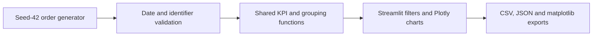
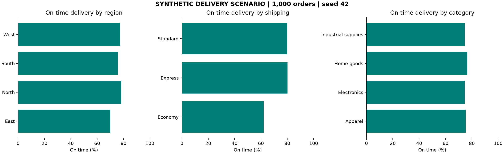
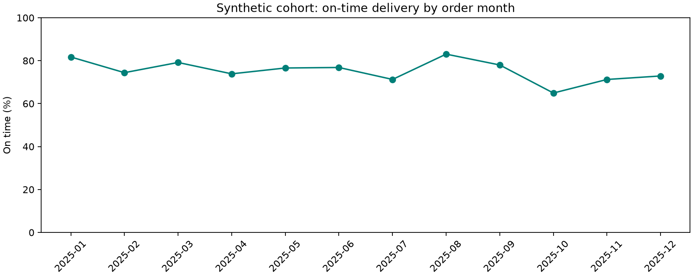

# Supply Chain Delivery Performance Dashboard

An interactive delivery-performance dashboard that derives order-level service KPIs, compares operational segments and exports reproducible analytical evidence from a fixed synthetic order cohort.

> Data boundary: all 1,000 orders and delivery outcomes are synthetic. Results describe the generated scenario, not an observed company.

## Contents

- [Overview](#overview)
- [Dataset and data contract](#dataset-and-data-contract)
- [Architecture and components](#architecture-and-components)
- [Processing pipeline](#processing-pipeline)
- [Configuration and metric definitions](#configuration-and-metric-definitions)
- [Recorded results and evidence](#recorded-results-and-evidence)
- [Interpretation and operational use](#interpretation-and-operational-use)
- [Running locally](#running-locally)
- [Validation and reproducibility](#validation-and-reproducibility)
- [Project structure](#project-structure)
- [Technology stack](#technology-stack)
- [Limitations and next steps](#limitations-and-next-steps)
- [Further technical documentation](#further-technical-documentation)

## Overview

Which product categories, shipping methods and regions have the greatest delivery delays, and where should an operations manager investigate first?

The dashboard compares delivery promises with actual delivery dates, shows the order counts behind each comparison and updates every chart and recommendation when filters change.

## Dataset and data contract

- **Source:** the `generate_orders()` function in [app.py](app.py). No external download, login or paid service is needed.
- **Generated file:** [data/synthetic_orders.csv](data/synthetic_orders.csv), 1,000 rows with 11 columns including derived fields.
- **Reproducibility:** NumPy random generator, seed **42**. Order dates: **1 January to 20 December 2025**. All deliveries are complete in this historical fictional scenario.
- **Why synthetic:** a controlled, complete schema permits reproducible validation of every delivery-date field. It is not evidence that suitable real delivery datasets do not exist.

| Column | Meaning |
|---|---|
| order_id | Unique fictional order ID; one row per order |
| order_date | Order placement date; also used for date filters and monthly cohorts |
| promised_delivery_date | Promised arrival date |
| actual_delivery_date | Recorded arrival date |
| shipping_method | Standard, Express or Economy |
| product_category | Apparel, Electronics, Home goods or Industrial supplies |
| region | North, South, East or West; fictional regions |
| order_value | Positive value in fictional currency units; not used to weight delivery KPIs |
| delay_days | Maximum of actual minus promised calendar days and zero |
| on_time | True for arrival on or before the promise |
| order_month | Order date's month, used for the trend chart |

Generator assumptions are deliberately visible: base lateness probability is 12%, with additions of 13 percentage points for East, 16 for Economy, 7 for Electronics and 10 for October-December orders. These are teaching assumptions, not real-world estimates. Late orders receive 1-6 days of delay; other orders arrive on the promise or one day early. Promised transit is 4/2/7 days for Standard/Express/Economy. Finite random samples need not reproduce the expected ranking for every category.

## Architecture and components



| Component | Entry points or assets | Responsibility |
|---|---|---|
| [app.py](app.py) | generate_orders / prepare_orders | Deterministic cohort generation, date validation and derived delivery fields. |
| [app.py](app.py) | metrics / performance / filter_orders | One authoritative calculation path for KPIs, grouped comparisons and filtered views. |
| [app.py](app.py) | recommendations / export_report | Minimum-sample investigation rules and full-cohort saved reports. |
| [app.py](app.py) | run_dashboard | Streamlit controls, interactive charts, reset behavior and filtered CSV download. |
| [test_dashboard.py](test_dashboard.py) | Automated checks | Hand-counted KPI fixtures, deterministic generation and UI filtering/empty-state checks. |

## Processing pipeline

1. Generate the fixed fictional order cohort and validate unique IDs, complete fields, positive values and delivery-date ordering.
2. Derive one consistent set of on-time and delay columns.
3. Calculate order count, on-time percentage, mean delay and late-order count.
4. Compare region, shipping and category groups, retaining denominators.
5. Plot monthly on-time rates by order-date cohort and apply interactive filters.
6. Suggest three investigation priorities from observed group averages, requiring at least 10 orders per group.
7. Export reproducible data, measured metrics, group summaries and a static figure.

## Configuration and metric definitions

| Control or measure | Definition |
|---|---|
| Cohort | 1,000 completed orders, NumPy generator seed 42 |
| On-time indicator | `actual_delivery_date <= promised_delivery_date` |
| Delay | `max(actual_delivery_date - promised_delivery_date, 0)` in calendar days |
| On-time percentage | `100 * on_time_orders / selected_orders` |
| Mean delay | Sum of nonnegative delays divided by all selected orders, including zero-delay orders |
| Trend cohort | Order month, rather than delivery month |
| Investigation sample floor | At least 10 orders per candidate group |

Region, shipping method, product category and the inclusive order-date range constrain the same underlying view. Empty selections do not produce fabricated percentages. Monetary order values neither weight delivery KPIs nor establish a cost of delay.

## Recorded results and evidence

These numbers were computed from the generated full cohort. Dashboard values change with filters.

| Metric | Actual computed value |
|---|---:|
| Delivered orders | 1,000 |
| On-time orders | 753 |
| Late orders | 247 |
| On-time delivery rate | 75.3% |
| Average delay across all orders | 0.889 days |

**Definitions:** on-time rate = on-time orders / all selected orders. Average delay includes zero-delay early/on-time orders; it is **not** average delay among late orders. Dates use calendar days. Every group is unweighted by order value.

[Application screenshot](outputs/dashboard.png)





Raw evidence: [metrics](outputs/metrics.json), [regions](outputs/by_region.csv), [shipping methods](outputs/by_shipping_method.csv), [categories](outputs/by_category.csv), [monthly cohorts](outputs/monthly_performance.csv), [recommendations](outputs/recommendations.md).

Verification includes hand-calculated early/on-time/late examples, deterministic generation, invalid data, filter behaviour, empty selections and reset. See [test_dashboard.py](test_dashboard.py). Runtime and browser review details are in [outputs/verification.md](outputs/verification.md).

## Interpretation and operational use

- **East:** 69.9% on time and 1.13 delay days per order across 256 orders. In this scenario, start by reviewing regional exceptions and handoffs; the dashboard does not establish a cause.
- **Economy:** 62.1% on time and 1.34 delay days per order across 264 orders. Investigate dispatch timing and whether the promise matches the service rather than automatically switching every order to Express.
- **Industrial supplies:** the highest sampled category average, 0.92 delay days per order across 237 orders. Review category-specific handling, while noting the small differences between category averages. The generator's Electronics assumption does not guarantee Electronics will rank worst in this finite sample.

These are suggestions for investigating the **fictional scenario**. No actual operational intervention, savings or delivery improvement was measured.

## Running locally

Prerequisite: Python **3.12+** and a terminal; verified using Python 3.12. No cloud account, API key or GPU is required. From the repository root, use these three commands in your Python environment:

```powershell
cd projects/01-delivery-performance-dashboard
python -m pip install -r requirements.txt
python -m streamlit run app.py
```

Open **http://127.0.0.1:8501**. Stop the server with Ctrl+C. In this prepared workspace the tested interpreter is `../../.venv/Scripts/python.exe`; it can replace `python` in the last two commands. That local environment is ignored by Git and is not required on another laptop.

Optional maintenance, separate from launching: `python app.py --export` regenerates the CSV and full-cohort outputs; `python -m unittest -v` runs the checks. The app itself regenerates the same cohort in memory, so it remains usable even if generated CSVs are missing. The export and UI share the same generator and KPI functions.

## Validation and reproducibility

The automated suite contains **5 tests**. It checks the following implementation boundaries:

Test implementation: [test_dashboard.py](test_dashboard.py).

- Seed and date integrity.
- Kpis include early and exactly on time.
- Missing and duplicate data are rejected.
- Empty filter and small sample.
- App filter empty and reset.

From the project directory, run:

```powershell
python -m unittest -v
```

Recorded execution and any browser-review evidence is retained in [outputs/verification.md](outputs/verification.md). Reported figures correspond to saved execution artifacts; running a report generator can overwrite its generated outputs. Package requirements, source checksums and fixed parameters define the reproducibility boundary; elapsed times and some model/solver outputs can vary across environments.

## Project structure

```text
01-delivery-performance-dashboard/
  app.py
  PROJECT_FILES.md
  README.md
  requirements.txt
  test_dashboard.py
  data/
    Bundled inputs, provenance and prepared data
  outputs/
    Recorded metrics, audit files, tables and figures
```

Generated environments, database files, model artifacts and compiled assets follow the project's [.gitignore](.gitignore). The [copyable source bundle](PROJECT_FILES.md) mirrors the README and contains individual file blocks.

## Technology stack

Python, NumPy, pandas, Streamlit, Plotly, matplotlib and standard-library unittest. Streamlit/Plotly provide interactive charts; matplotlib produces the saved PNG. Direct dependencies are pinned to the versions verified in this workspace. No paid services or external runtime connections.

## Limitations and next steps

- All records and lateness assumptions are invented; results cannot validate real-company performance or business savings.
- Only delivered orders are included. A live operational dashboard would also need pending, overdue and cancelled orders with a clearly defined reporting date.
- Different service promises affect comparisons. Order counts, service mix, seasonality and uncertainty need consideration before action; these charts show associations.
- Monthly rates use order date, not actual delivery date. Partial filtered months may have different sample sizes.
- The MVP has no real carrier integration, persistent database, authentication, statistical significance analysis or deployment service.
- Future improvements: public real delivery data with documented permission, unresolved-order handling and uncertainty estimates.

## Further technical documentation

- [Pinned Python dependencies](requirements.txt)
- [Recorded execution and verification evidence](outputs/verification.md)
- [Folder structure and individually copyable source files](PROJECT_FILES.md)

[Back to contents](#contents)
